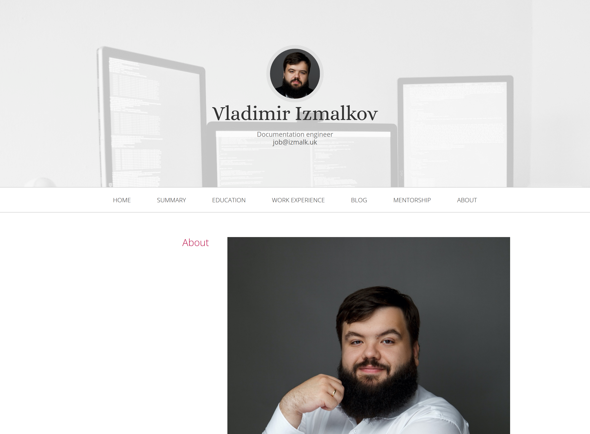
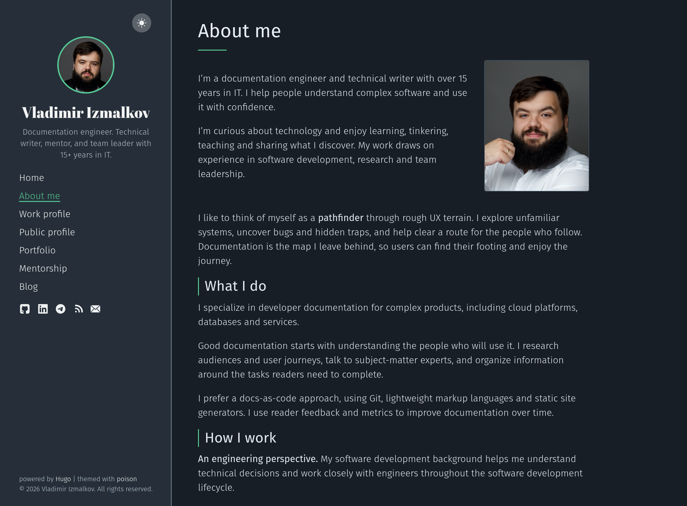
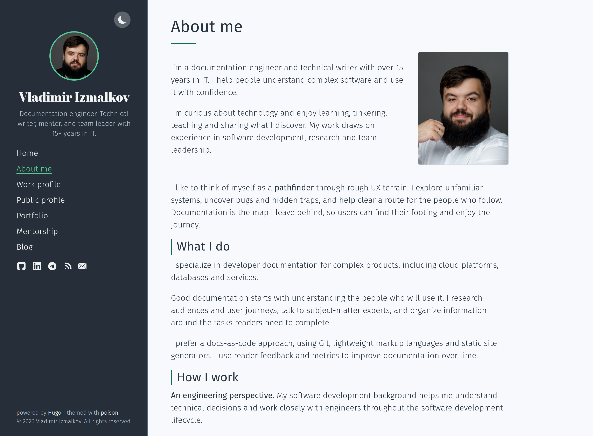
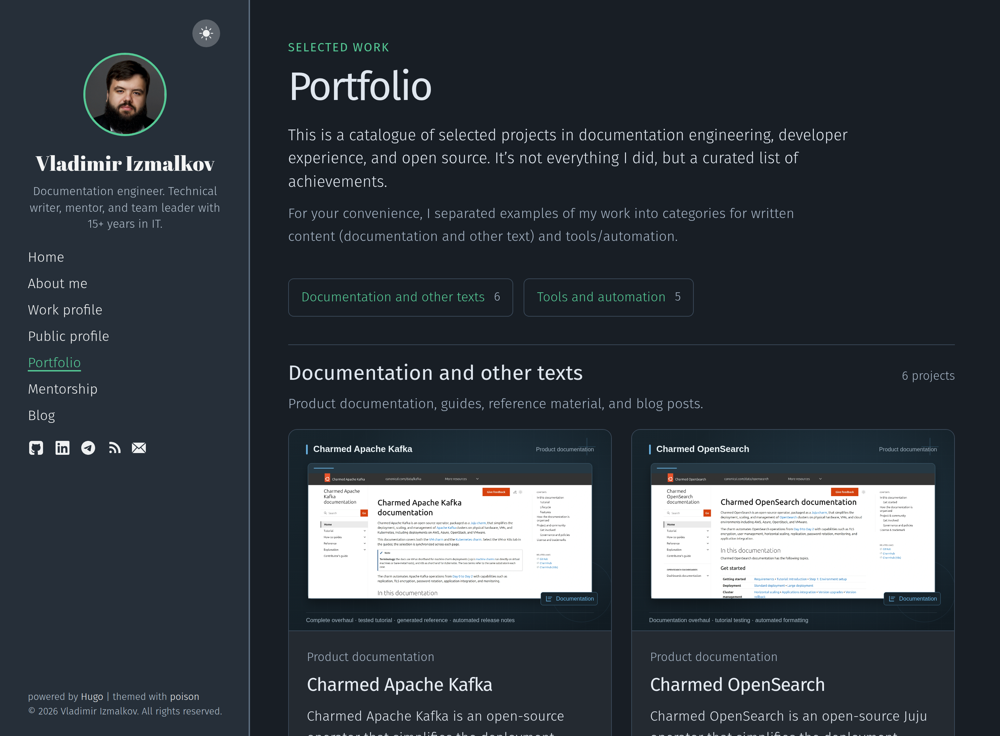
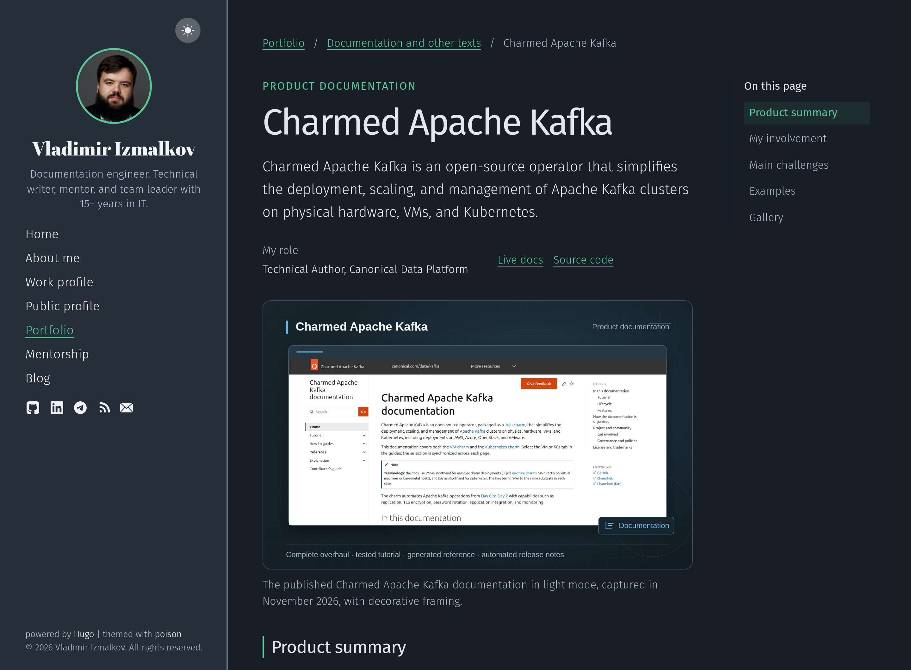

Over the past couple of weeks, I've been working on something that was overdue: redesigning my personal website. I wanted it to look professional and modern, and to give a clearer picture of what I do today.

That meant a new design, rewritten and reorganised pages, a new Public profile, and the biggest addition: a proper **Portfolio** with examples of my documentation work and tools.

<!--more-->

## A website that had fallen behind

I put the previous version of this site together in 2022. Apart from occasional posts and additions, it had barely changed since 2024. My work had moved on, but the site was still doing much the same job, in much the same way.

It had a large header, a conventional top menu and separate pages for different parts of my professional background. The information was there, but it needed a fresh look and a better structure.

I wanted someone arriving at the site to be able to answer a few questions quickly: What kind of work do I do? Where can they see examples? Can they find my talks, or book a mentorship session?

## A new design and a clearer reading layout

The site still uses Hugo, but I replaced the old Initio theme with Poison and adapted it to suit the content. The new design uses slate greys and emerald accents, with a persistent sidebar on desktop and a reading column for the page itself.

The sidebar brings the main destinations together. Longer pages have a local contents list, with the current section highlighted as you scroll. The home page now leads with blog post previews, giving new writing a more visible place on the site.

Dark mode is the default, and there is a light mode for readers who prefer it. Both use the same palette and navigation. I also worked through the smaller-screen layout, where the sidebar and contents need to make room for reading.

## Rewriting and reorganising the pages

Changing the theme was only part of the work. I went through the main pages to make their purpose clearer and bring the content up to date.

- [About me]() now introduces my work as a documentation engineer, how I approach unfamiliar systems, and how I work with people.
- [Work profile]() brings my summary, work experience and education into one page, alongside professional community activities and a downloadable résumé.
- The new [Public profile]() collects my talks, podcast appearances, workshops, courses and interviews. Those now have a home beyond individual links scattered across platforms.
- [Mentorship]() remains a dedicated page for the programmes and booking information. It now fits the new design and includes a dated snapshot of my ADPList activity.

## Finally, a proper Portfolio

In August 2022, I wrote a [Portfolio post]() saying that the page was not ready yet. More than four years later, it seemed like a good time to deliver on that promise!

The new [Portfolio]() has two collections: **Documentation and other texts**, and **Tools and automation**. The first includes work on Kafka, OpenSearch, TypeDB, VK Private Cloud and Tarantool Data Grid, as well as my BusyRebar build article. The second brings together Ulwazi and tools for testing, reviewing and publishing documentation.

Each project has its own page explaining the product or problem, my involvement, and the main challenges. There are links to specific examples and galleries of real documentation, interfaces or output, so readers can inspect the work for themselves.

The [Kafka page](), for example, connects the account of my work with a tutorial, a deployment guide, reference material and an explanation of the components. It gives those samples context: what I worked on and the decisions behind it.

Some work needs historical context. Older samples use archived documentation or excerpts from the original documents, with dates and captions distinguishing them from newer live documentation. I also wanted the descriptions to make my own contribution clear within work done by a team.

## Making the examples easier to explore

Documentation screenshots need to be readable. I added a shared image viewer so readers can enlarge an image, switch between fitting it on screen and viewing it at actual size, then close it and return to where they were reading. You can try it with the screenshots in this post.

Underneath the redesign, this remains a static Hugo site. The custom layouts, styles and image-viewer behaviour live alongside the content in the repository. There is now a reusable structure for adding portfolio projects, rather than a separate page design to maintain for every example.

This was a chance to apply the same questions I ask when working on documentation to my own website: Who is coming here? What are they trying to find? What will help them understand the work?

Have a look around the new [Portfolio](), or explore the [Public profile](). I'd be glad to hear what you think.
